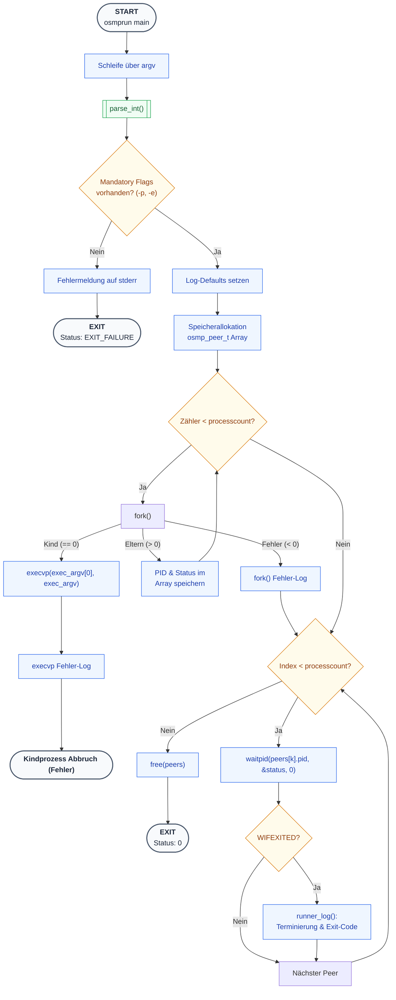

# Architektur der Prozesssteuerung (osmprun)

Das folgende Diagramm beschreibt den internen Kontrollfluss des Runners. Es verdeutlicht die Trennung zwischen der Konfigurationsphase, der Prozess-Instanziierung und dem Ressourcen-Management.

## Technische Details der Implementierung

### 1. Konfigurations-Logik
Der Runner nutzt eine Schleife über `argv`, um Parameter flexibel zu erfassen. Die Funktion `parse_int` kapselt dabei die `strtol`-Logik inklusive Error-Checking (Overflow, ungültige Zeichen), was die `main` übersichtlich hält.

### 2. Prozess-Lifecycle
*   **Fork-Schleife:** Erzeugt die Prozesse sequentiell. Kritische Fehler beim `fork()` führen nicht zum sofortigen Abbruch des gesamten Runners, sondern erlauben das Einsammeln bereits gestarteter Prozesse.
*   **Exec-Übergang:** Durch `execvp` wird das Abbild des Runners im Kind durch das Zielprogramm ersetzt. Die Argumente ab dem Flag `-e` werden dabei transparent durchgereicht.

### 3. Monitoring & Cleanup
Die `waitpid`-Schleife ist blockierend ausgelegt, um sicherzustellen, dass keine Zombie-Prozesse verbleiben. Erst nach dem erfolgreichen `wait` auf alle Indizes wird der dynamisch allokierte Speicher des Peer-Arrays freigegeben.

### 4. Logging-System
Die Funktion `runner_log` wird zentral für Statusmeldungen genutzt. Sie stellt durch ein verbindliches Format (`Timestamp Verbosity PID Message`) sicher, dass die Logs maschinenlesbar bleiben.
